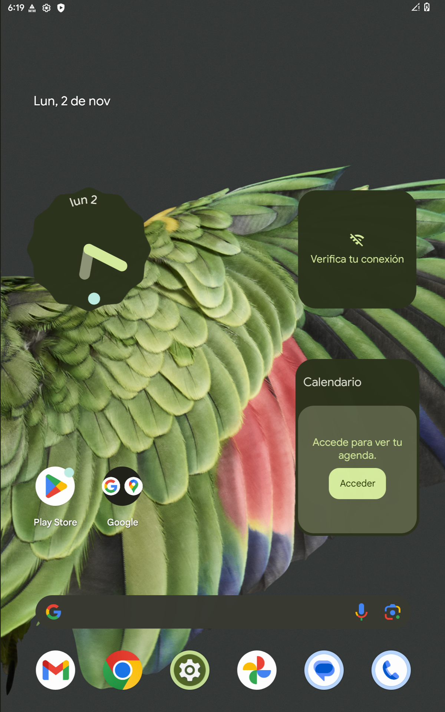
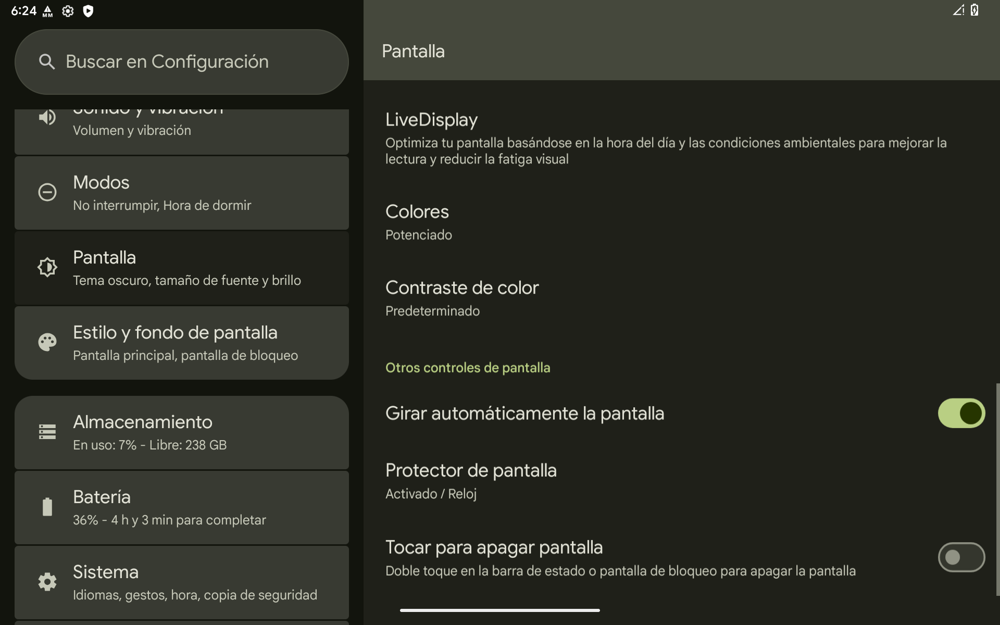
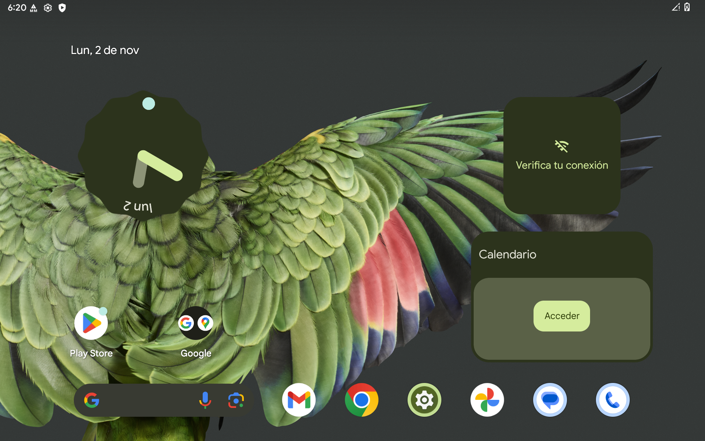

# 🚀 PixelOS (Pixel Experience) Android 15 para Cubot KingKong Tab

[-green?style=for-the-badge&logo=android)](https://www.android.com/)
[](https://cubot.net/)
[-red?style=for-the-badge)](https://www.mediatek.com/)
[](https://store.google.com/product/pixel_tablet)

Guía completa y herramientas automatizadas para transformar la **Cubot KingKong Tab (MT8788 / 8GB RAM / 256GB ROM)** en una auténtica **Google Pixel Tablet** corriendo **Android 15 puro**.

Diseñado tanto para uso diario ultra-fluido como para integración en tableros de automóviles (**Car Dashboard / Navegación**).

---

## 📸 Capturas de Pantalla Reales (En el Dispositivo)

| Pantalla de Inicio (Pixel Launcher) | Menú de Ajustes Tablet (Doble Columna) | Vista Horizontal (Landscape 1920x1200) |
|:---:|:---:|:---:|
|  |  |  |

---

## ✨ Características y Mejoras

* **Android 15 Oficial (BP1A.250505.005 / API 35):** Base moderna con el parche de seguridad más reciente.
* **Experiencia Google Pixel Tablet Nativa:**
  * Pixel Launcher oficial con buscador de Google, micrófono del Asistente y Google Lens.
  * Widget *At A Glance* (De un vistazo) con pronóstico del clima y eventos.
  * **Barra de tareas flotante para tablets (Taskbar)** para multitarea instantánea y pantalla dividida.
  * Paleta de colores dinámicos **Material You** adaptada al fondo de pantalla.
* **Google Mobile Services (GApps) Nativas:** Google Play Store con certificación Play Protect, Google Maps, Fotos, Chrome, Gmail y Drive.
* **Optimizaciones al 1000% Aplicadas:**
  * **GPU Mali-G72 MP3:** Renderizado por hardware con Ganesh GLES 3.2 sin tirones (`latch_unsignaled=1`).
  * **Animaciones Ultra-Rápidas (0.75x):** Respuestas instantáneas y cero retraso al abrir o cambiar de apps.
  * **Gestión de Memoria (8 GB RAM):** LMK configurado para retener hasta 48 aplicaciones abiertas en memoria sin cierres forzados.
  * **Modo Vehículo / Coche:**
    * Encendido automático al recibir corriente por USB / mechero del coche (`off-mode-charge 0`).
    * Pantalla siempre encendida mientras recibe carga (`stay_on_while_plugged_in 3`).
    * Rotación automática completa de 360 grados.

---

## 🛠️ Requisitos Previos (Para Principiantes)

1. Una tablet **Cubot KingKong Tab** con batería al menos al 50%.
2. Un cable USB Tipo C de buena calidad.
3. Una computadora con **Windows 10 u 11**.
4. Descargar este repositorio:
   * Puedes hacer clic en el botón verde **`Code`** arriba y seleccionar **`Download ZIP`**, luego descomprimirlo en tu computadora.

---

## 📋 Guía de Instalación Paso a Paso (Desde Cero)

### Paso 1: Activar Opciones de Desarrollador y Desbloqueo OEM
1. En la tablet, entra a **Ajustes** -> **Información del tablet**.
2. Baja hasta **Número de compilación** y presiónalo **7 veces seguidas** hasta que diga *"¡Ya eres desarrollador!"*.
3. Regresa a **Ajustes** -> **Sistema** -> **Opciones para desarrolladores**.
4. Activa las siguientes opciones:
   * **Desbloqueo de OEM** (Permite desbloquear el cargador de arranque).
   * **Depuración por USB** (Permite conectar con la computadora).

---

### Paso 2: Instalar los Drivers USB
1. Conecta la tablet a la computadora mediante el cable USB.
2. Si en la tablet aparece un cartel preguntando *"¿Permitir depuración por USB?"*, marca la casilla **Permitir siempre** y pulsa **Permitir**.
3. En tu PC, entra en la carpeta **`dist\`** y haz doble clic sobre:
   ```cmd
   install_driver.bat
   ```
4. Se abrirá el instalador oficial de controladores de Google / MediaTek. Sigue los pasos en pantalla hasta finalizar.

---

### Paso 3: Descargar la Imagen de la ROM (PixelOS Android 15)
Debido a que la imagen completa del sistema pesa más de 4 GB, no se almacena directamente dentro del código de GitHub. Puedes obtenerla de dos formas muy sencillas:

* **Opción Automática (Recomendada):**
  Entra en la carpeta `dist\` y haz doble clic en:
  ```cmd
  download_rom.bat
  ```
  El script descargará la ROM oficial comprimida y la descomprimirá automáticamente usando las herramientas incluidas.

* **Opción Manual:**
  1. Descarga el archivo comprimido desde el enlace oficial:  
     👉 [Descargar PixelOS 15 GSI (ARM64 bgN EXT4)](https://github.com/mytja/treble_pixelos/releases/download/20250517/pixelos_arm64_bgN_ext4-15.0-unofficial-20250517.img.xz)
  2. Descomprímelo con 7-Zip.
  3. Cambia el nombre del archivo resultante a:
     `PixelOS_15_CubotTab.img`
  4. Colócalo dentro de la carpeta `dist\`.

---

### Paso 4: Desbloquear el Bootloader (Solo la primera vez)
Si nunca has modificado tu tablet antes, debes desbloquear el bootloader:
1. Abre una ventana de comandos dentro de `dist\platform-tools\`.
2. Escribe:
   ```cmd
   adb reboot bootloader
   ```
   *(La tablet se reiniciará con una pantalla negra y letras pequeñas que dicen "=> FASTBOOT mode...")*.
3. Escribe:
   ```cmd
   fastboot flashing unlock
   ```
4. En la pantalla de la tablet aparecerá una pregunta. Presiona el botón de **Volumen Arriba (+)** para confirmar el desbloqueo.  
   *(Nota: Esto borrará los datos de fábrica por seguridad)*.

---

### Paso 5: Instalar PixelOS 15 en 1 Solo Clic
1. Con la tablet conectada por USB, entra en la carpeta **`dist\`** de tu PC.
2. Haz doble clic sobre:
   ```cmd
   flash_pixelos_android15.bat
   ```
3. El instalador automático se encargará de todo:
   * Reiniciará la tablet en modo **Fastbootd** (Dynamic Partitions).
   * Creará y flasheará la partición de compatibilidad de MediaTek (`product_a`).
   * Flasheará el sistema **PixelOS Android 15** en `system_a`.
   * Formateará `userdata` y `metadata` para un arranque limpio y seguro.
   * Configurará la directiva de encendido automático para vehículos (`off-mode-charge 0`).
   * Reiniciará la tablet automáticamente.

🎉 **¡Listo! Tu Cubot KingKong Tab iniciará con el logo de Google y la pantalla de bienvenida de Android 15.**

---

## 🔧 Solución de Problemas Frecuentes

* **¿El instalador dice `< waiting for any device >`?**  
  Falta el controlador Fastboot en Windows. Abre el Administrador de Dispositivos de Windows, busca el dispositivo con signo de exclamación amarillo (`Android`), selecciona *Actualizar controlador* -> *Examinar mi PC* y selecciona la carpeta `dist\usb_driver\`.

* **¿La tablet entra en bucle en el recovery o dice "Can't load Android system"?**  
  En el menú de Recovery de la tablet, selecciona **Wipe data / factory reset** usando los botones de volumen y confirma con el botón de encendido. Luego reinicia.

* **¿Cómo activar la barra de tareas de tablet (Taskbar)?**  
  En Android 15, la barra de tareas se activa manteniendo presionado levemente la línea de navegación inferior o deslizando despacio hacia arriba desde el borde inferior de la pantalla.

---

## ⚖️ Licencia y Agradecimientos

* ROM Base: [Treble PixelOS por mytja](https://github.com/mytja/treble_pixelos)
* Android Open Source Project (AOSP) & Google Pixel Experience.
* Optimización, scripts de instalación y adaptación para Cubot KingKong Tab por [Jesus Obregon](https://github.com/jesusobregon453-cmyk).
